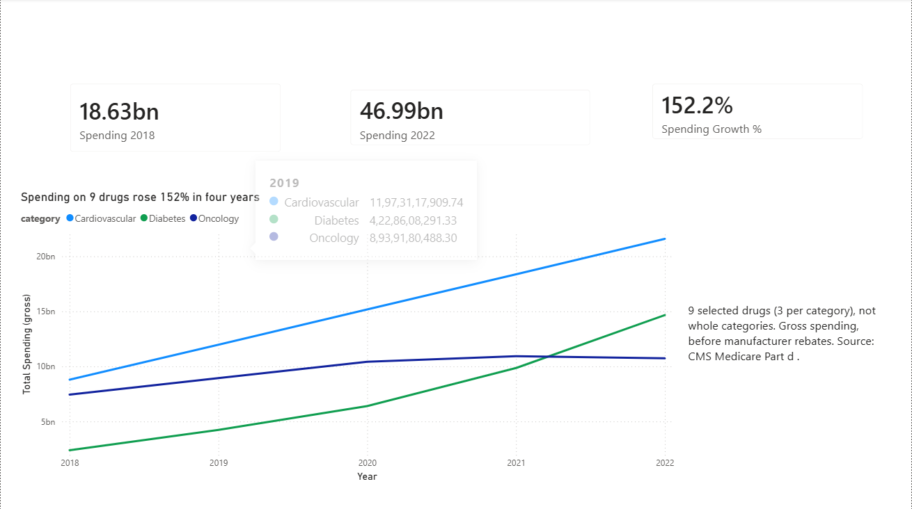
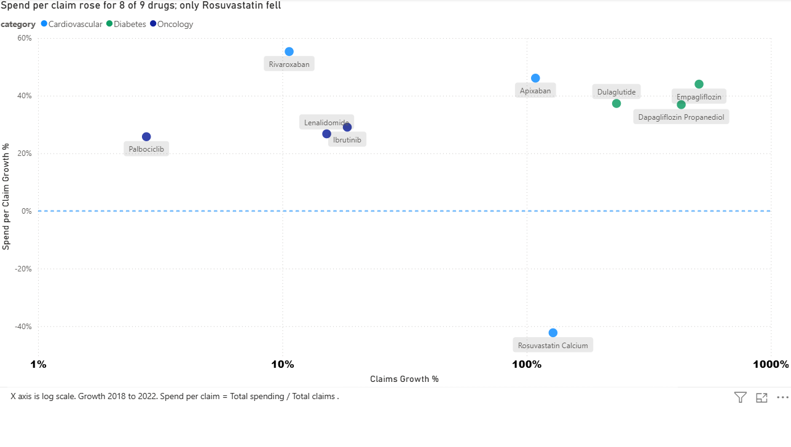
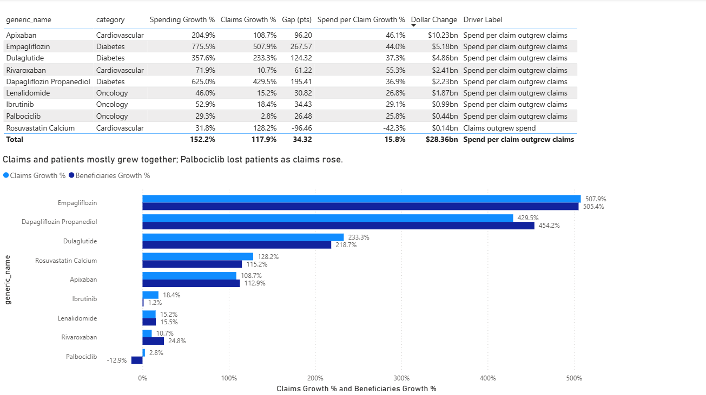
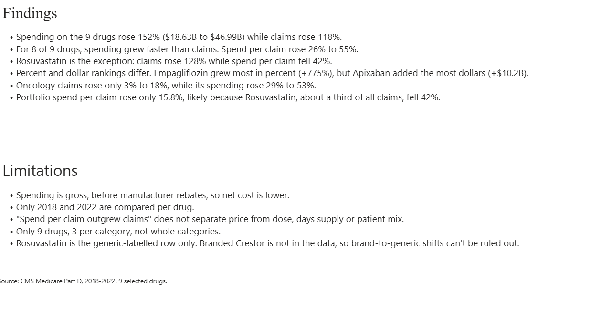

# CMS Medicare Part D Drug Spending: Utilization vs. Spending Dynamics

## Project Overview

An exploratory healthcare analytics project analysing Medicare Part D spending patterns across 9 high-spend drugs from 2018 to 2022.

The project investigates whether rising drug spending was primarily associated with increased prescription claims (utilization), higher spending per claim, or a combination of both. It also compares spending patterns across Cardiovascular, Diabetes, and Oncology drug categories.

Built using **Power Query, MySQL, SQL, Power BI and DAX**, this project demonstrates an end-to-end healthcare data analytics workflow using publicly available CMS data.

## Business Problem

Healthcare spending can increase for several reasons, including greater medication utilization and higher expenditure per prescription claim.

The objective of this analysis is to understand:

- Did Medicare Part D spending grow faster than prescription claims between 2018 and 2022?
- Which drugs contributed most to the increase in total spending?
- Which drugs experienced the highest percentage and absolute spending growth?
- How did spending and utilization patterns differ across therapeutic categories?
- Did beneficiary growth follow the same pattern as prescription claim growth?
- Which drugs showed a decline in spending per claim despite increasing utilization?

## Dataset Information

- **Source:** CMS Medicare Part D Spending by Drug public dataset.
- **Time Period:** 2018–2022.
- **Scope:** 9 drugs across 3 therapeutic categories.
- **Final Dataset:** 45 rows (9 drugs × 5 years).
- **Geographical Scope:** United States Medicare Part D programme.

### Drugs Included

| Category       | Drugs                                                                                   |
|----------------|-----------------------------------------------------------------------------------------|
| Cardiovascular | Apixaban (Eliquis), Rivaroxaban (Xarelto), Rosuvastatin Calcium                         |
| Diabetes       | Dulaglutide (Trulicity), Empagliflozin (Jardiance), Dapagliflozin Propanediol (Farxiga) |
| Oncology       | Lenalidomide (Revlimid), Ibrutinib (Imbruvica), Palbociclib (Ibrance)                   |

**Final MySQL table:** `cms_medicare.cms_part_d_clean`

### Dataset Columns

1. `brand_name`
2. `generic_name`
3. `category`
4. `data_year`
5. `total_spending`
6. `total_claims`
7. `total_beneficiaries`
8. `avg_spend_per_claim`

*Note: Spending represents gross expenditure before manufacturer rebates.*

## Technology Stack

| Tool        | Application                       |
|-------------|-----------------------------------|
| Excel / CSV | Source data handling              |
| Power Query | Data cleaning and transformation  |
| MySQL       | Data storage and querying         |
| SQL         | Data analysis and validation      |
| Power BI    | Interactive dashboard development |
| DAX         | Calculated measures and KPIs      |

## End-to-End Project Workflow

**1. Data Collection**

Obtained publicly available Medicare Part D drug spending data from CMS.

**2. Data Cleaning and Transformation**

Used Power Query to:

- Clean and standardize the source datasets.
- Correct data types.
- Handle inconsistent column structures.
- Append nine source datasets into one consolidated dataset.

**3. Database Development**

Imported the cleaned dataset into MySQL.

Created the database `cms_medicare` and table `cms_part_d_clean`.

**4. SQL Analysis**

Performed seven analytical queries using:

- Common Table Expressions (CTEs).
- Conditional aggregation using `SUM(CASE WHEN ...)`.
- CASE statements for classification.
- ROUND for numerical precision.
- Growth calculations.
- Category-level comparisons.
- Data completeness checks.

**5. Power BI Development**

Connected Power BI to MySQL using Import mode and a read-only MySQL user.

Developed DAX measures for:

- Total spending.
- Total claims.
- Total beneficiaries.
- 2018 and 2022 comparisons.
- Spending growth percentage.
- Claims growth percentage.
- Spending per claim growth.
- Dollar change.
- Spending versus claims growth gap.
- Beneficiary growth.
- Category spending share.

**6. Validation**

Reconciled Power BI totals, drug-level growth rates and the Rosuvastatin record against MySQL query outputs.

## Analytical Methodology

### Key Metrics

**1. Spending Growth (%)**

(2022 Spending − 2018 Spending) / 2018 Spending × 100

**2. Claims Growth (%)**

(2022 Claims − 2018 Claims) / 2018 Claims × 100

**3. Spending per Claim**

Total Spending / Total Claims

Calculated from aggregate totals rather than averaging the source-level average spending per claim.

**4. Growth Gap (Percentage Points)**

Spending Growth % − Claims Growth %

### Classification Logic

- Gap above +10 percentage points: Spending grew faster than claims.
- Gap below −10 percentage points: Claims grew faster than spending.
- Gap between −10 and +10 percentage points: Relatively balanced growth.

The smallest absolute gap in this dataset is 26.5 percentage points. Therefore, cutoffs between 5 and 25 percentage points produce the same classifications.

## SQL Analysis and Business Insights

| #  | Analytical Question                      | Key Result                                                                     |
|----|------------------------------------------|--------------------------------------------------------------------------------|
| 1  | Is the dataset complete?                 | 45 rows, 9 drugs, 3 categories, 5 years each, no NULLs                         |
| 2  | How did category spending change?        | Cardiovascular +145%, Diabetes +515%, Oncology +44%                            |
| 3  | Which drugs led spending in 2022?        | Apixaban ranked first at $15.22B                                               |
| 4  | Which drugs grew fastest?                | Empagliflozin +775.5% in percentage terms                                      |
| 5  | How did claims and beneficiaries change? | Palbociclib was the only drug with a decline in beneficiaries                  |
| 6  | Did spending outgrow claims?             | Yes, for 8 of 9 drugs                                                          |
| 7  | How concentrated was category spending?  | Apixaban represented 70.5% of the selected Cardiovascular drugs' 2022 spending |

**SQL techniques demonstrated:** CTEs, conditional aggregation, CASE statements, ROUND, growth calculations and analytical comparisons.

**Full SQL script:** [cms_part_d_queries.sql](cms_part_d_queries.sql)

## Key Findings

1. **Overall spending increased substantially:** Spending across the nine selected drugs rose 152%, from $18.63 billion in 2018 to $46.99 billion in 2022.
2. **Spending grew faster than utilization:** Total prescription claims increased 118%, compared with 152% spending growth.
3. **Spending per claim increased for most drugs:** Eight out of nine drugs experienced faster spending growth than claims growth. Their spending per claim increased by approximately 26%–55%.
4. **Rosuvastatin showed an opposite trend:** Claims increased 128.2%, while spending per claim declined 42.3%, from $47.79 to $27.59.
5. **Empagliflozin led percentage growth:** Its spending increased 775.5%, while Apixaban contributed the largest absolute dollar increase of approximately $10.23 billion.
6. **Oncology showed relatively low claims growth:** Oncology spending increased 29%–53% across the selected drugs, while claims growth ranged from approximately 3%–18%.
7. **Diabetes changed its spending position:** It moved from the smallest selected category in 2018 to the second-largest in 2022, overtaking Oncology.
8. **Utilization and beneficiary growth differed:** Ibrutinib claims increased 18.4%, while beneficiaries increased only 1.2%. Rivaroxaban beneficiaries increased 24.8%, compared with 10.7% claims growth.
9. **Portfolio-level spending per claim increased less than most individual drugs:** The aggregate basket's spending per claim increased approximately 15.8%. Rosuvastatin's high share of claims and declining spending per claim likely contributed to this difference.

## Drug-Level Comparison (2018–2022)

| Drug                      | Category       | Spending Growth | Claims Growth | Spend per Claim Growth | Dollar Change |
|---------------------------|----------------|----------------:|--------------:|-----------------------:|--------------:|
| Apixaban                  | Cardiovascular | +204.9%         | +108.7%       | +46.1%                 | +$10.23B      |
| Empagliflozin             | Diabetes       | +775.5%         | +507.9%       | +44.0%                 | +$5.18B       |
| Dulaglutide               | Diabetes       | +357.6%         | +233.3%       | +37.3%                 | +$4.86B       |
| Rivaroxaban               | Cardiovascular | +71.9%          | +10.7%        | +55.3%                 | +$2.41B       |
| Dapagliflozin Propanediol | Diabetes       | +625.0%         | +429.5%       | +36.9%                 | +$2.23B       |
| Lenalidomide              | Oncology       | +46.0%          | +15.2%        | +26.8%                 | +$1.87B       |
| Ibrutinib                 | Oncology       | +52.9%          | +18.4%        | +29.1%                 | +$0.99B       |
| Palbociclib               | Oncology       | +29.3%          | +2.8%         | +25.8%                 | +$0.44B       |
| Rosuvastatin Calcium      | Cardiovascular | +31.8%          | +128.2%       | -42.3%                 | +$0.14B       |

## Power BI Dashboard

The Power BI report has four pages, built in Power BI Desktop with Import mode.

**1. Overview**

- KPI cards for 2018 spending ($18.63B), 2022 spending ($46.99B) and spending growth (152.2%).
- Line chart of total spending by category, 2018 to 2022.

**2. Spending vs Usage**

- Scatter chart of claims growth (log scale) against spending per claim growth for each drug.
- A 0% reference line: drugs above it had higher spending per claim in 2022 than in 2018.

**3. Drug Details**

- Table of spending growth, claims growth, spending per claim growth, dollar change and a growth-gap label for each drug.
- Bar chart comparing claims growth with beneficiary growth for each drug.

**4. Findings**

- Written key findings and limitations.

## Repository Contents

- `README.md`: project documentation
- `cms_part_d_queries.sql`: the seven SQL analysis queries
- `cms_part_d_analysis.pbix`: Power BI report file
- `cms_part_d_dashboard.pdf`: PDF export of the four report pages
- `overview.png`, `spending_vs_usage.png`, `drug_details.png`, `findings.png`: report page screenshots

## Data Validation and Quality Checks

The following checks were performed:

- Verified 45 total records.
- Checked all nine drugs across five years.
- Checked for NULL values.
- Reconciled total spending against MySQL outputs.
- Compared individual drug growth calculations.
- Validated the Rosuvastatin record separately.
- Used aggregate spending and claims to calculate spending per claim.

**Reconciled portfolio spending:**

- 2018: $18.63 billion.
- 2022: $46.99 billion.

## Limitations and Considerations

- CMS spending figures represent gross spending before manufacturer rebates. Actual net expenditure may differ.
- The main growth comparison uses 2018 and 2022 endpoints; it does not explain every annual movement between those years.
- Spending per claim is not equivalent to a drug's unit price. It may also reflect dosage, days supplied and patient mix.
- The analysis does not establish that price increases caused higher spending.
- Only nine selected drugs are included. Category totals represent the selected drugs, not the entire Cardiovascular, Diabetes or Oncology markets.
- The Rosuvastatin record represents the generic-labelled row. Branded Crestor is not included, so brand-to-generic substitution cannot be ruled out.
- The portfolio-level explanation involving Rosuvastatin's claim share is a plausible interpretation, not a separately tested causal result.

## Skills Demonstrated

- Healthcare and pharmaceutical data analysis.
- Data cleaning and transformation.
- Relational database handling.
- SQL querying and analytical calculations.
- CTEs and conditional aggregation.
- Power Query transformations.
- Power BI dashboard development.
- DAX measures and KPI creation.
- Data validation and reconciliation.
- Business interpretation and insight communication.

## Data Source

CMS Medicare Part D Spending by Drug:

[https://www.cms.gov/data-research/statistics-trends-and-reports/medicare-part-d-spending-by-drug](https://www.cms.gov/data-research/statistics-trends-and-reports/medicare-part-d-spending-by-drug)

## Project Objective

This project demonstrates how publicly available healthcare data can be transformed into structured analytical insights using SQL and Power BI.

The focus is not only on reporting spending figures, but also on understanding the relationship between prescription utilization, spending per claim and beneficiary trends across selected pharmaceutical products.

---

**Tools:** Power Query | MySQL | SQL | Power BI | DAX

**Domain:** Healthcare Analytics | Pharmaceutical Analytics | Medicare Part D

**Analysis Period:** 2018–2022
